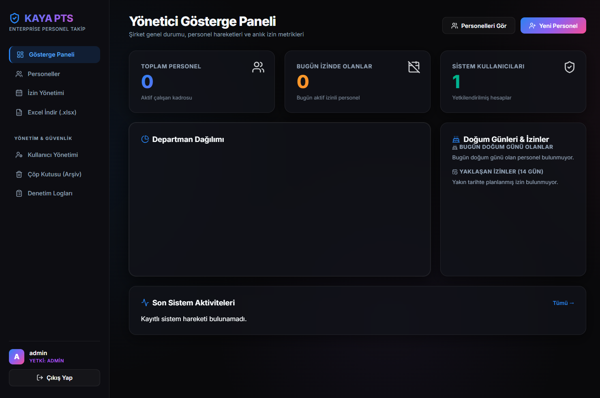
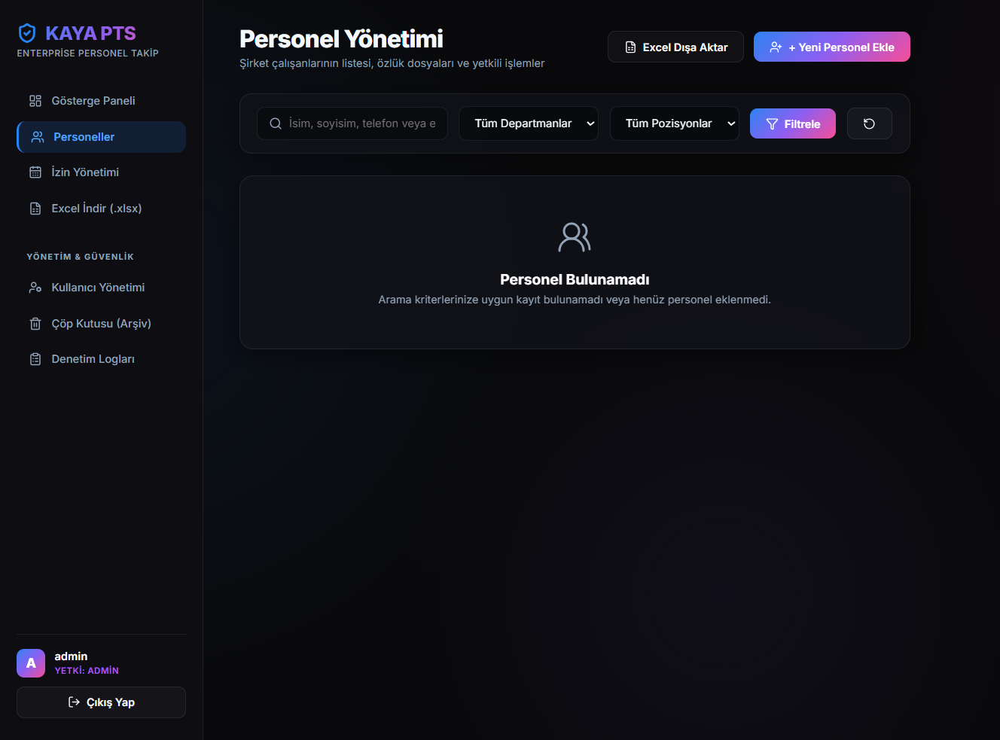
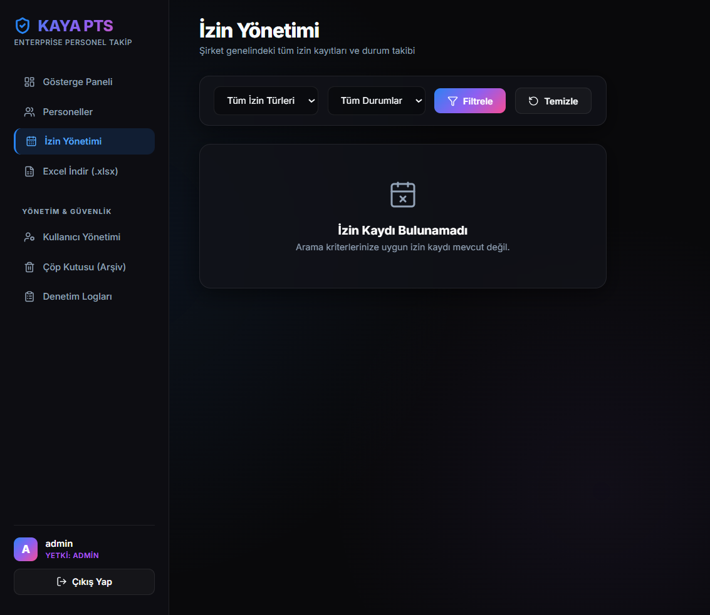
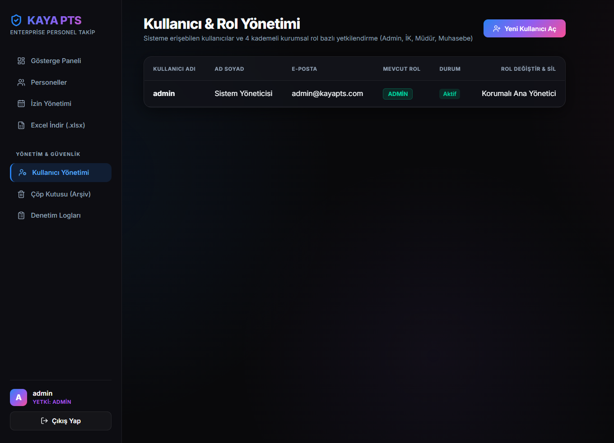
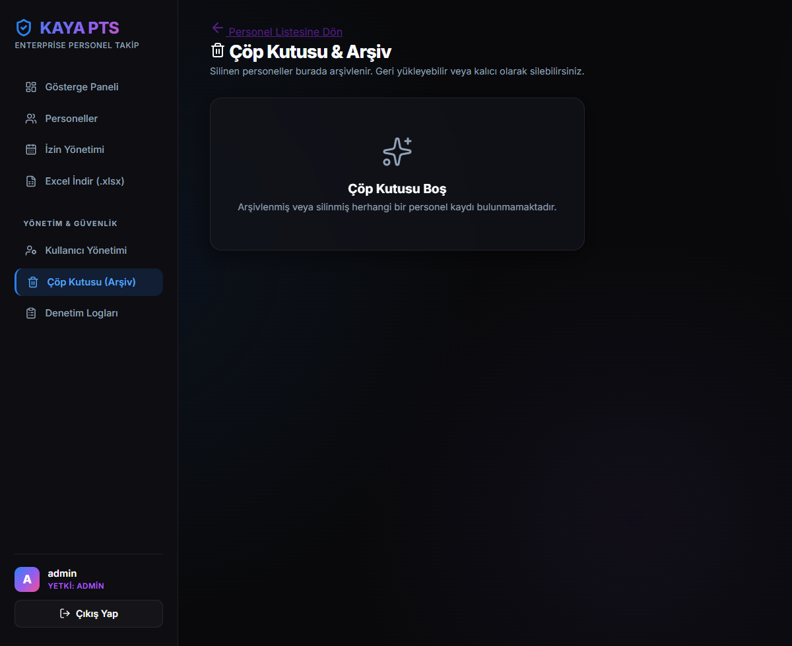
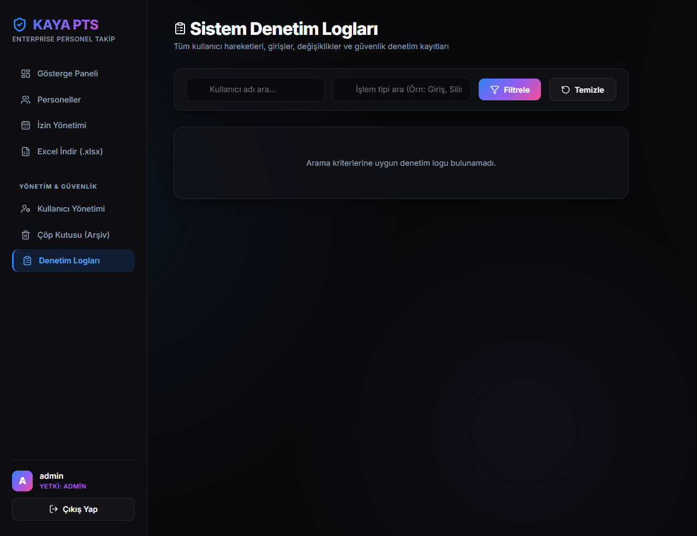

# 🛡️ KAYA PTS — Enterprise Personel Takip ve Yönetim Sistemi

[🇹🇷 Türkçe](README.md) | [🇬🇧 English](README_EN.md)

[](https://github.com/nrkaya/personnel-management-system/actions/workflows/tests.yml)

**KAYA PTS (Kaya Personel Takip Sistemi)**; kurumsal şirketlerin insan kaynakları, izin süreçleri, departman analitiği ve bordro/maaş yönetimini en üst düzey güvenlik, modern cam efektli (Glassmorphism) kullanıcı deneyimi ve modüler mimari ile buluşturan yeni nesil kurumsal bir web platformudur.

---

## 📸 Ekran Görüntüleri & Arayüz Turu

### ⚡ Yönetici Gösterge Paneli (Executive Dashboard)


<details>
  <summary><b>🔍 Diğer Modüllerin Ekran Görüntülerini İncelemek İçin Tıklayın (Daraltılabilir Menü)</b></summary>
  <br>

  #### 👥 1. Personel Yönetimi (Canlı Filtreleme & Arama)
  

  #### 📅 2. İzin Yönetimi & Onay İş Akışları
  

  #### 🛡️ 3. Kullanıcı & 4 Kademeli Rol Yönetimi (RBAC)
  

  #### 🗑️ 4. Çöp Kutusu & Geri Yükleme Arşivi
  

  #### 📜 5. Sistem Denetim Logları (Audit Trails)
  

</details>

---

## 🌟 Öne Çıkan Özellikler

- 🏗️ **Modüler Mimari (Flask Blueprints):** 7 bağımsız iş modülü (`auth`, `dashboard`, `personel`, `izin`, `kullanici`, `logs`, `api`).
- 🔐 **Katmanlı Kurumsal Güvenlik:**
  - **CSRF Koruması:** `Flask-WTF` ile tüm form ve AJAX isteklerinde token doğrulaması.
  - **Brute-Force & Rate Limiting:** Aynı hesap/IP için art arda 5 hatalı denemede giriş **10 dakika kilitlenir**. Hata mesajı her durumda aynıdır ve bilinmeyen kullanıcı adları da aynı maliyetle doğrulanır; böylece hangi kullanıcı adının var olduğu anlaşılamaz.
  - **Şifre Güvenlik Politikası:** En az 12 karakter; büyük/küçük harf, rakam ve özel karakter zorunluluğu. Kullanıcılar kendi şifresini değiştirebilir, Admin şifre sıfırlayabilir.
  - **Güvenli Fotoğraf Yükleme:** Görseller Pillow ile doğrulanıp yeniden kodlanır (EXIF/konum bilgisi silinir), rastgele UUID ile adlandırılır ve herkese açık `static` klasörü yerine `uploads/` altında tutulur; yalnızca giriş yapmış ve o kaydı görmeye yetkili kullanıcılara sunulur.
  - **Güvenli Oturumlar:** `HttpOnly`, `SameSite=Lax`, 8 saat ömür. Çıkış, şifre değişikliği ve hesap pasifleştirme o kullanıcının **tüm** oturum çerezlerini geçersiz kılar.
  - **Sıkı İçerik Güvenlik Politikası (CSP):** Satır içi script yoktur; Lucide, Chart.js ve Inter fontu `static/vendor` altından sunulur, ziyaretçi verisi üçüncü taraf CDN'lere gitmez.
  - **Denetim Logları (Audit Logging):** Kimin, hangi IP ile hangi saatte ne işlem yaptığı saklanır; `flask purge-logs` ile saklama süresi uygulanır.
  - **Excel Formül Enjeksiyonu Koruması:** `=`, `+`, `-`, `@` ile başlayan değerler dışa aktarımda düz metin olarak yazılır.
- 👥 **4 Kademeli Rol ve Yetkilendirme (RBAC):** `Admin`, `IK`, `Müdür`, `Muhasebe`.
- 📊 **Bento Grid Yönetici Paneli:** Chart.js departman dağılım grafikleri, doğum günü kutlamaları ve yaklaşan izin takip widget'ları.
- 📱 **Mobil Uyumlu:** Telefonda yan menü, üst çubuktaki menü butonuyla açılan bir çekmeceye dönüşür.
- 💾 **Yedekleme:** `backup_db.py` SQLite ve PostgreSQL veritabanını personel fotoğraflarıyla birlikte yedekler; Docker Compose kurulumunda günlük otomatik yedek servisi vardır.
- ✅ **Sürekli Entegrasyon:** Her push ve pull request'te GitHub Actions testleri çalıştırır ve migration'ların modellerle uyumunu SQLite ve PostgreSQL üzerinde doğrular.
- ⚡ **Yüksek Performanslı Arayüz:** Sayfa başına 10 personel sayfalama (pagination) ve anlık canlı filtreleme/arama motoru.
- 📑 **Kurumsal Excel Raporlama:** `openpyxl` ile biçimlendirilmiş, renkli başlıklı `.xlsx` dışa aktarımı.
- 🌐 **RESTful API v1:** Harici sistem entegrasyonları için `X-API-KEY` korumalı JSON API servisi.
- 🐳 **DevOps & Docker:** Tek komutla ayağa kalkan `Dockerfile` ve `docker-compose.yml` (PostgreSQL desteğiyle).

---

## 👥 4 Kademeli Rol ve Yetki Matrisi (RBAC)

| Yetki / İşlem | 👑 Admin | 💼 İK (İnsan Kaynakları) | 👔 Müdür | 💰 Muhasebe |
| :--- | :---: | :---: | :---: | :---: |
| **Giriş & Dashboard** | ✅ | ✅ | ✅ | ✅ |
| **Personel Listesini Görme** | ✅ | ✅ | 🔸 kendi departmanı | ✅ |
| **Personel Ekleme / Düzenleme** | ✅ | ✅ | ❌ | ❌ |
| **Personel Silme & Çöp Kutusu** | ✅ | ✅ | ❌ | ❌ |
| **Çöp Kutusundan Kalıcı Silme** | ✅ | ❌ | ❌ | ❌ |
| **Maaş Bilgilerini Görme** | ✅ | ✅ | ❌ | ✅ |
| **Doğum Tarihi & Özlük Notları** | ✅ | ✅ | ❌ | ❌ |
| **İzin Talebi / Onaylama / Reddetme** | ✅ | ✅ | 🔸 kendi departmanı | ❌ |
| **İzin Açıklamasını Görme** | ✅ | ✅ | 🔸 kendi departmanı | ❌ |
| **İzin Kaydı Silme** | ✅ | ✅ | ❌ | ❌ |
| **Excel Raporu İndirme** | ✅ | ✅ | 🔸 kendi departmanı | ✅ |
| **Kullanıcı & Rol Yönetimi** | ✅ | ❌ | ❌ | ❌ |
| **Sistem Denetim Logları** | ✅ | ❌ | ❌ | ❌ |

> Müdür hesapları bir departmana bağlıdır (Kullanıcı Yönetimi'nden atanır). Departmanı atanmamış bir müdür hiçbir personel kaydını göremez. Yetkiler `utils.py` içindeki tek bir matristen (`ROLE_HIERARCHY`) okunur; butonlar yalnızca ilgili işlem izinliyse görünür.

---

## 🚀 Kurulum ve Çalıştırma

### Yöntem 1: Yerel Olarak Çalıştırma (Geliştirme Modu - SQLite)

1. **Gereksinimler:** Python 3.10+
2. **Sanal ortamı ve sırları hazırlayın:**
   ```powershell
   cd C:\Users\Muhammed\Desktop\personelsistemi
   Copy-Item .env.example .env
   # .env içindeki SECRET_KEY ve API_KEY yer tutucularını benzersiz değerlerle değiştirin.
   .\venv\Scripts\python -m pip install -r requirements.txt
   .\venv\Scripts\python -m flask --app app:create_app db upgrade
   .\venv\Scripts\python -m flask --app app:create_app create-admin
   .\venv\Scripts\python app.py
   ```
3. **Tarayıcıdan Açın:**
   👉 **`http://127.0.0.1:5000`**
4. Yönetici hesabı yalnızca `create-admin` komutunda girdiğiniz bilgilerle oluşturulur; kodda varsayılan hesap veya parola bulunmaz.

> **Güncelleme notu:** Bu sürüm yeni bir veritabanı migration'ı içerir. Güncellemeden sonra `flask --app app:create_app db upgrade` çalıştırın. Oturum çerezleri sürümlendiği için tüm kullanıcıların bir kez yeniden giriş yapması gerekir. Eski sürümde `static/uploads/` altına yüklenmiş fotoğraflar ilk açıldıklarında otomatik olarak `uploads/` klasörüne taşınır.

---

### Yöntem 2: Docker & PostgreSQL ile Çalıştırma (Production Modu)

```bash
docker-compose up --build -d
```
> Önce `.env.example` dosyasını `.env` olarak kopyalayıp tüm yer tutucu sırları ve PostgreSQL değişkenlerini doldurun. PostgreSQL hosta açılmaz; uygulama yalnızca `127.0.0.1:5000` üzerinde dinler ve TLS için reverse proxy bekler. İmaj açılışta migration'ları kendisi uygular (`flask db upgrade`). Reverse proxy arkasında `.env` içinde `TRUSTED_PROXY_COUNT=1` ayarlayın.

### Yöntem 3: Render (veya benzeri PaaS) üzerinde çalıştırma

Dockerfile, Render'ın verdiği `$PORT` değişkenini okur, `FLASK_ENV=production` ile açılır ve her deploy'da migration'ları uygular. Ortam değişkenleri:

| Değişken | Değer |
| :--- | :--- |
| `SECRET_KEY`, `API_KEY` | En az 32 karakterlik, birbirinden farklı rastgele değerler (`python -c "import secrets; print(secrets.token_urlsafe(48))"`). Repoda geçmişte görünen eski anahtarlar uygulama tarafından reddedilir. |
| `DATABASE_URL` | Render PostgreSQL bağlantı adresi. **SQLite kullanmayın**: Render'ın disk alanı her deploy'da sıfırlanır ve veriler silinir. |
| `TRUSTED_PROXY_COUNT` | `1` — aksi halde tüm ziyaretçiler proxy'nin IP'sini paylaşır; bir kişinin hatalı girişleri herkesi kilitler. |
| `RATELIMIT_STORAGE_URI` | Mümkünse Render Key Value (Redis) adresi; `memory://` worker'lar arasında paylaşılmaz. |

Personel fotoğraflarının kalıcı olması için `/app/uploads` yoluna bir Render Persistent Disk bağlayın. İlk yöneticiyi Render Shell'den `flask --app app:create_app create-admin` ile oluşturun.

### Bakım: Log saklama süresi (KVKK)

Denetim logları kişi adları ve IP adresleri içerir. Saklama süresini uygulamak için düzenli olarak (ör. günlük cron) çalıştırın:

```bash
flask --app app:create_app purge-logs            # LOG_RETENTION_DAYS (varsayılan 365) günden eski loglar
flask --app app:create_app purge-logs --days 180 # farklı bir süre
```

### Yedekleme

Her yedek, veritabanının bir kopyasını ve personel fotoğraflarının (`uploads/`) arşivini içerir. Fotoğraflar kişisel veridir ve yalnızca veritabanı yedeğiyle geri gelmez.

**Yerel (SQLite veya PostgreSQL):**

```powershell
.\venv\Scripts\python.exe backup_db.py --keep 14   # backups/ klasörüne yedek al, en yeni 14 yedeği tut
.\venv\Scripts\python.exe backup_db.py --list      # mevcut yedekleri listele
```

SQLite yedeği uygulama çalışırken de güvenle alınır. PostgreSQL için bilgisayarda `pg_dump` kurulu olmalı ve sürümü sunucununkiyle aynı veya daha yeni olmalıdır. Günlük yedek için komutu Windows Görev Zamanlayıcı'ya (veya Linux'ta cron'a) ekleyin; `BACKUP_DIR` ortam değişkeniyle yedekleri başka bir diske yazdırabilirsiniz.

**Docker Compose:** `backup` servisi her gün veritabanının dökümünü ve fotoğraf arşivini alır, `BACKUP_KEEP_DAYS` (varsayılan 14) günden eskileri siler. Yedekleri bilgisayara kopyalamak için:

```bash
docker compose cp backup:/backups ./backups
```

**Render:** Render'ın ücretsiz PostgreSQL planı yedek almaz ve belirli bir süre sonra silinir; gerçek veri için ücretli plan (otomatik günlük yedek) kullanın. Ek olarak kendi bilgisayarınızdan Render'ın *External Database URL* adresiyle yedek alabilirsiniz:

```powershell
$env:DATABASE_URL = "<Render External Database URL>"; .\venv\Scripts\python.exe backup_db.py --no-uploads
```

**Geri yükleme:**

| Ne | Nasıl |
| :--- | :--- |
| SQLite | Uygulamayı durdurun, `kaya_pts_<zaman>.db` dosyasını `database.db` yerine kopyalayın. |
| PostgreSQL | `pg_restore --clean --if-exists --no-owner -d "<veritabanı adresi>" kaya_pts_<zaman>.dump` |
| Fotoğraflar | `kaya_pts_<zaman>_uploads.zip` (Docker'da `.tar.gz`) içeriğini `uploads/` klasörüne çıkarın. |

> Yedekleri düzenli olarak farklı bir yere (harici disk, bulut depolama) kopyalayın; aynı sunucudaki yedek, sunucu kaybolursa işe yaramaz.

---

## 🌐 RESTful API v1 Dokümantasyonu

Tüm API uç noktaları `X-API-KEY` veya `Authorization: Bearer` ile korunur. Anahtarlar yalnızca `.env` üzerinden tanımlanır; `API_KEYS_JSON` ile dar kapsamlı ek anahtarlar eklenebilir.

| Kapsam (scope) | İzin verdiği |
| :--- | :--- |
| `personnel:read` | Personel listeleme ve tekil kayıt okuma |
| `personnel:write` | Personel ekleme, güncelleme, arşive taşıma |
| `personnel:salary` | `maas` alanını okuma ve yazma |
| `personnel:personal` | `dogum_tarihi` ve `ek_bilgi` alanlarını okuma ve yazma |
| `stats:read` | `/stats` ve `/docs` |

Kapsamı olmayan bir anahtar bu alanları yanıtta görmez; yazmaya çalışırsa `403` alır.

### 1. İstatistikleri Getir
* **GET** `/api/v1/stats`
* **Başlıklar:** `X-API-KEY: <.env içindeki API_KEY>`
* **Örnek Yanıt:**
  ```json
  {
    "success": true,
    "data": {
      "toplam_aktif_personel": 45,
      "toplam_kullanici": 4,
      "aktif_izindekiler": 2
    }
  }
  ```

### 2. Personelleri Listele
* **GET** `/api/v1/personeller?page=1&per_page=20&q=Ahmet&departman=Yazılım`
* **Başlıklar:** `X-API-KEY: <.env içindeki API_KEY>`

### 3. Yeni Personel Ekle
* **POST** `/api/v1/personel`
* **Body (JSON):**
  ```json
  {
    "ad": "Mehmet",
    "soyad": "Kaya",
    "departman": "Yazılım",
    "pozisyon": "Senior Backend Developer",
    "telefon": "0555 123 4567",
    "email": "mehmet@kayapts.com",
    "maas": 95000
  }
  ```

### 4. Personel Güncelle
* **PUT** `/api/v1/personel/<id>`
* **Body (JSON):** `{"maas": 105000, "pozisyon": "Lead Developer"}`

### 5. Personel Sil (Soft Delete)
* **DELETE** `/api/v1/personel/<id>`

---

## 🧪 Otomatik Testler

Proje bünyesindeki tüm kimlik doğrulama, brute-force kilitlenmesi, şifre politikası, RBAC yetkileri, CRUD, Excel çıktısı ve API testlerini çalıştırmak için:

```powershell
.\venv\Scripts\python -m unittest -v
```
> Testler yetkisiz uç nokta erişimi, API doğrulama sınırları, RBAC, CRUD, izin, Excel çıktısı ve yedeklemeyi kapsar. GitHub Actions aynı testleri her push ve pull request'te otomatik çalıştırır (`.github/workflows/tests.yml`).

---

## 📁 Proje Dosya Yapısı

```
personelsistemi/
├── app.py                  # Application Factory (create_app)
├── config.py               # Development, Production, Testing ayarları
├── database.py             # SQLAlchemy & CSRF Protect instance
├── models.py               # ORM Tabloları (Kullanici, Personel, Izin, Log, LoginAttempt)
├── utils.py                # RBAC decorator, Rate Limit, Dosya/Şifre doğrulama
├── test_enterprise.py      # Otomatik test paketi
├── test_security.py        # Güvenlik, gizlilik ve rol testleri
├── test_backup.py          # Yedekleme testleri
├── backup_db.py            # Veritabanı + fotoğraf yedeği
├── clean_system.py         # Sistem sıfırlama ve temizlik scripti
├── routes/
│   ├── auth.py             # Giriş, Çıkış, Rate Limit
│   ├── dashboard.py        # Bento Grid, İstatistikler
│   ├── personel.py         # CRUD, Canlı Arama, Sayfalama, Excel
│   ├── izin.py             # İzin onaylama iş akışı
│   ├── kullanici.py        # 4 Kademeli Rol ve Kullanıcı Yönetimi
│   ├── logs.py             # Denetim / Audit Logları
│   └── api.py              # RESTful API v1
├── templates/              # Cam efektli (Glassmorphism) Jinja2 şablonları
├── static/
│   ├── css/style.css       # Kurumsal koyu tema, Bento Grid CSS
│   ├── js/main.js          # Modal, onay, grafik ve canlı arama (CSP uyumlu)
│   └── vendor/             # Lucide, Chart.js ve Inter fontu (yerel kopya)
├── uploads/                # Personel fotoğrafları (git'e girmez, herkese açık değil)
├── migrations/             # Alembic veritabanı migration'ları
├── Dockerfile              # Production Docker image
├── docker-compose.yml      # PostgreSQL + Web container
├── requirements.txt        # Python kütüphane bağımlılıkları
└── README.md               # Proje dokümantasyonu
```

---
*© 2026 KAYA PTS — Kurumsal Personel Takip Sistemi. Tüm Hakları Saklıdır.*
